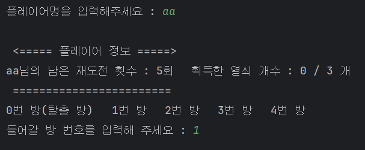
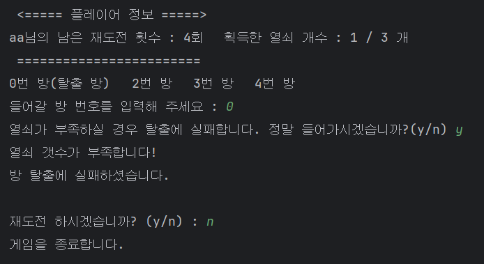
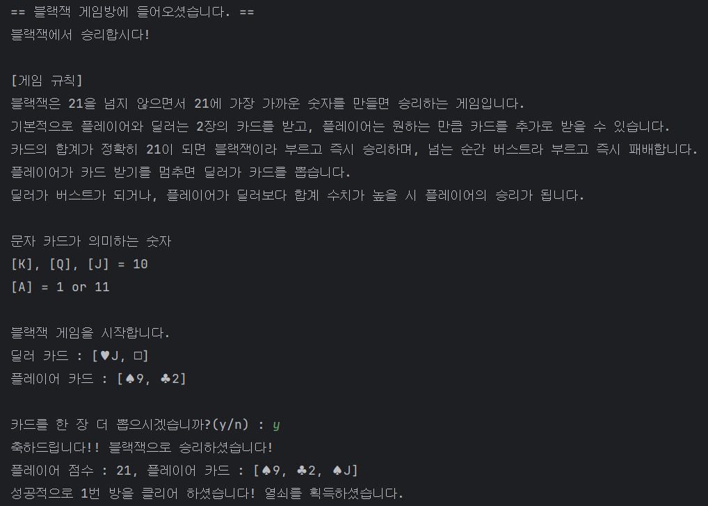
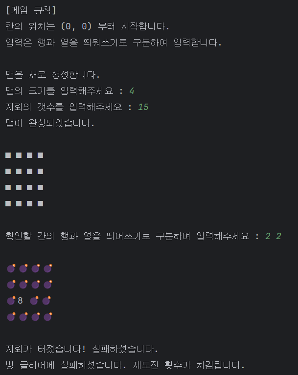
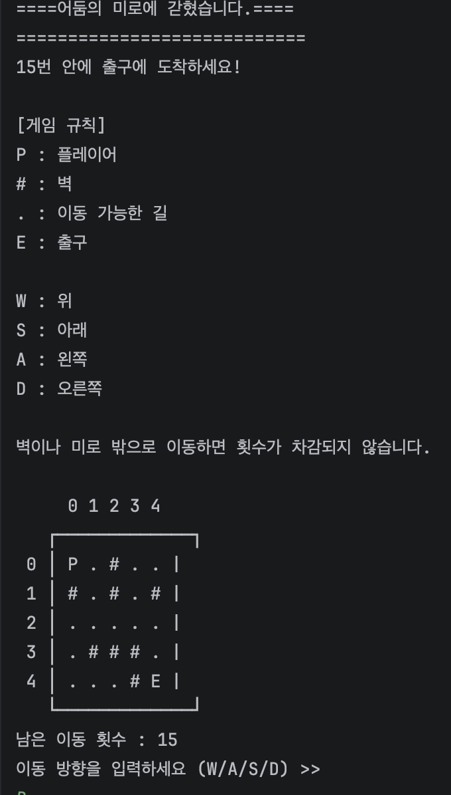
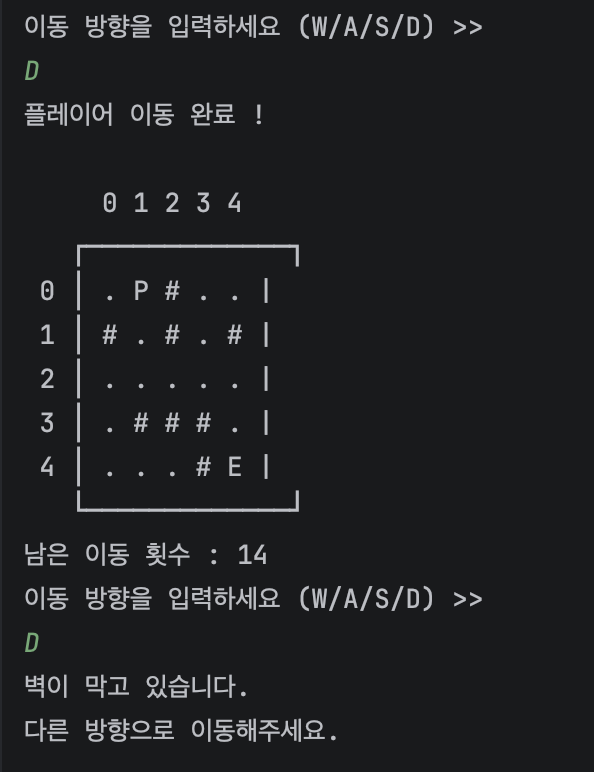
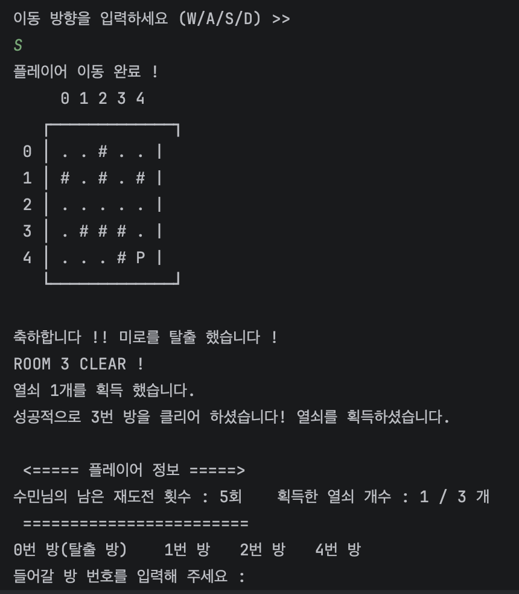
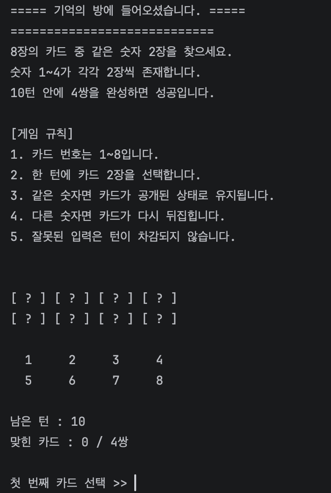
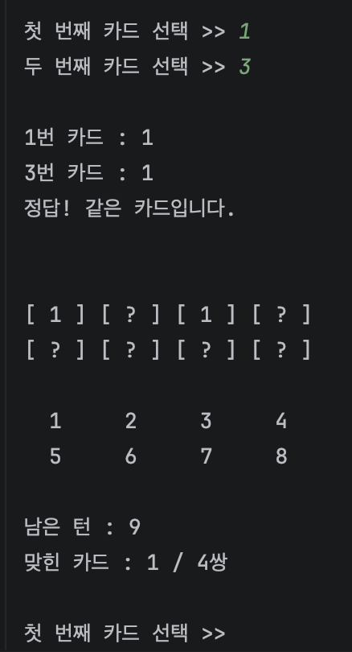
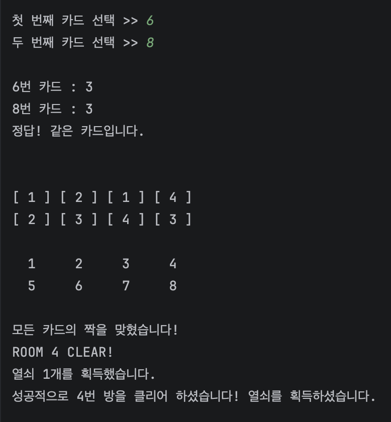

# 방탈출 미니게임
프로젝트 진행 기간 : 2026-10-14 ~ 2026-10-18 (약 5일간)  
팀원 : 류가연, 한수민

## 프로젝트 개요
당신은 갖혔습니다.  
미니게임을 클리어하고 열쇠를 3개 모아 탈출 방으로 탈출하세요!

&nbsp;

## 프로젝트 구조
```
/main   - Application
/game   - GameManager
/player - Player
/room   - Room          - Blackjack
                        - Minesweeper
                        - Maze
                        - Memory
                        - EndRoom
```
### 객체 지향 설계
- **추상화** : `ROOM` 추상 클래스로 게임 승리의/패배 시 공통 동작 정의
- **상속 & 다형성** : 미니 게임 방들이 `ROOM` 을 상속받아 `play()` 와 `printRule()` 을 구현하여 플레이와 룰 설명을 각각 다르게 동작
- **캡술화** : 플레이어의 정보를 private 로 보호하고 열쇠, 재도전 횟수 관리 등을 메소드를 통해 조작

### 디자인 패턴
싱글톤 : GameManager 는 프로젝트에 하나만 존재해야 하므로 싱글톤으로 구성하여 플레이어 상태 등을 관리

### 확장성
- 미니 게임 방 갯수를 MAX_ROOM 으로 작성하여 유동적으로 쉽게 미니게임을 추가할 수 있는 구성이 되도록 작성

&nbsp;

## 공통 화면
게임 시작 화면  



&nbsp;

게임 종료 화면  



&nbsp;

## 미니 게임
### 블랙잭
딜러와 승부를 벌여 21 에 가장 가까운 21이 넘지 않는 합계가 되도록 카드를 뽑는 게임  
- 점수를 계산할 때 A 카드가 1 이나 11 이 될 수 있기에 재귀 방식으로 가장 적절한 점수가 되도록 계산함  
- 플레이어가 카드를 뽑을 때마다 이미 나오지 않은 카드면 랜덤하게 배부하고 점수를 계산하여 분기 처리  




### 지뢰 찾기
지뢰를 피해 안전한 칸만 선택하는 게임  
- 지뢰 맵 크기와 지뢰 갯수를 플레이어가 원하는 만큼 받아 생성  
- 맵에 랜덤하게 지뢰를 설정하고 지뢰 이외의 칸은 주변 8칸을 확인하여 지뢰 갯수 설정
- 지뢰 위치를 받을 때 정규식으로 올바른 입력 확인  




### 어둠의 미로
5×5 미로에서 장애물을 피해 제한된 이동 횟수 안에 출구에 도달하는 게임

- 2차원 배열로 미로를 구성하고, W/A/S/D 입력에 따라 플레이어의 좌표가 변경되도록 구현
- 이동 전 배열의 범위와 벽 충돌 여부를 검사하여, 유효한 이동에만 횟수가 차감되도록 처리
- 플레이어의 현재 위치를 실시간으로 출력하고, 15회 이내 출구 도착 여부에 따라 성공과 실패를 판정
<br> <br>
- 게임 시작 화면
<br> <br>

<br> <br>
- 플레이어 이동 화면
  <br> <br>

  <br> <br>
- 방 탈출 시 화면
  <br> <br>



### 기억의 방
무작위로 배치된 카드 8장 중 같은 숫자의 카드 4쌍을 맞추는 게임

- Math.random()과 임시 변수를 이용한 배열 요소 교환 방식으로 카드 배치를 무작위화
- boolean[] 배열로 카드별 짝 맞추기 여부를 관리하여, 정답 카드는 공개 상태를 유지하도록 구현
- 카드 중복 선택 및 잘못된 입력을 검증하고, 10턴 이내에 4쌍을 완성했는지에 따라 성공과 실패를 판정
  <br> <br>
- 게임 시작 화면
  <br> <br>
  
  <br> <br>
- 게임 실행 중 화면
  <br> <br>
  
  <br> <br>
- 방 탈출 시 화면
  <br> <br>
  


&nbsp;

## 프로젝트 후기
- 시간이 적어서 구조를 대략적으로만 정하고 프로젝트를 시작했는데, 추상클래스를 중간에 약간 수정하게 되어서, 인터페이스나 추상 클래스를 써서 다형성을 적용할거라면 아무리 급하더라도 시간을 들여서 구성을 짜야 한다는걸 느끼게 되었습니다.  
- 사용자 입력값 검증과 성공·실패 조건을 구현하며 예외 처리와 로직 설계의 중요성을 배웠습니다.
  개발 중 추상 클래스를 수정하면서 다형성을 고려한 초기 설계의 필요성을 느꼈습니다.
  이를 통해 기능 구현뿐 아니라 클래스 간 구조와 연동을 고려하는 것이 중요하다는 것을 깨달았습니다.